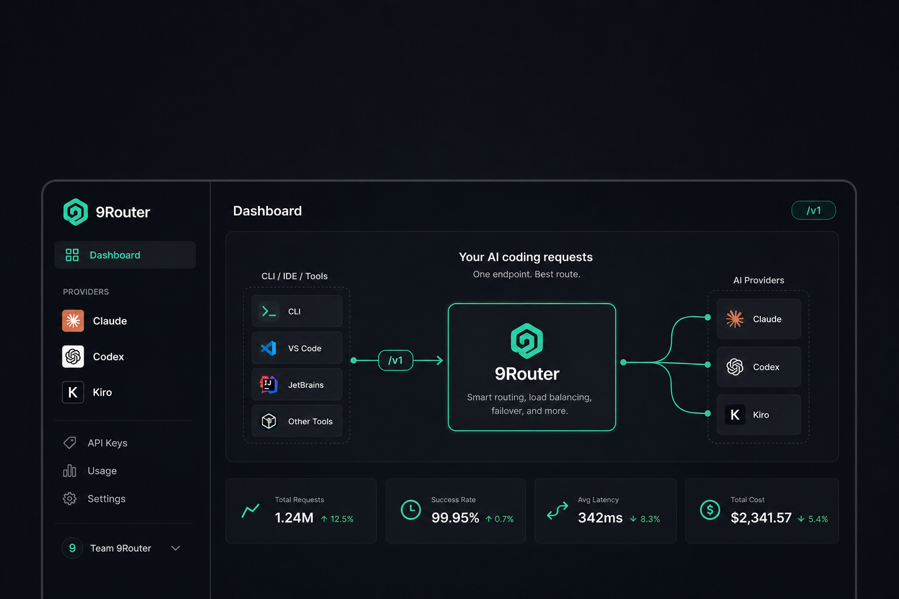
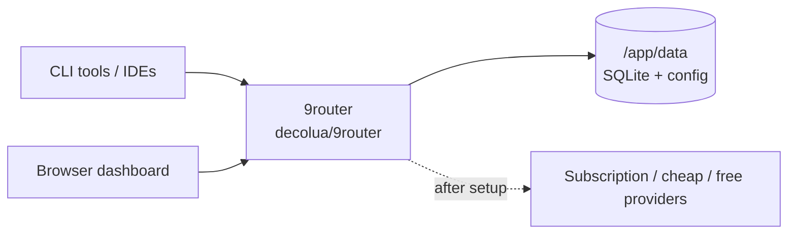

<div align="center">

# 9Router on Render

Deploy **9Router**, the free AI coding router with RTK token savings and multi-provider fallback, on Render with the official Docker image and a persistent disk for SQLite.

<p>
  <a href="https://render.com/deploy-template/api/github/start?template_repo=9router-render-template">
    
  </a>
</p>

<p>
  <a href="https://render.com">
    
  </a>
  <a href="https://github.com/decolua/9router">
    
  </a>
  <a href="https://hub.docker.com/r/decolua/9router">
    
  </a>
  <a href="https://9router.com">
    
  </a>
</p>

</div>



## What This Template Shows

This repo packages the official `decolua/9router` image as a one-click Render Blueprint:

| Piece | Role |
| --- | --- |
| **[9Router](https://github.com/decolua/9router)** | OpenAI-compatible `/v1` proxy + dashboard for Claude Code, Cursor, Codex, Cline, and other CLI tools |
| **[decolua/9router](https://hub.docker.com/r/decolua/9router)** | Official multi-arch image (linux/amd64 + arm64) |
| **[Render Web Service](https://render.com/docs/web-services)** | Runs the image on a Standard instance |
| **[Render Disk](https://render.com/docs/disks)** | Persists SQLite, provider config, keys, and usage history at `/app/data` |

No source build on Render. Provider OAuth and API keys are configured in the 9Router UI after first login.

## Architecture



### How It Works

1. Click **Deploy to Render**. Render forks this template into your GitHub account and applies [`render.yaml`](./render.yaml).
2. On Apply, set `INITIAL_PASSWORD`. `BASE_URL` / `NEXT_PUBLIC_BASE_URL` are wired automatically from Render’s public URL.
3. Render pulls `decolua/9router:0.5.45`, mounts a 5 GB disk at `/app/data`, and starts on port `20128`.
4. Open the `*.onrender.com` URL, sign in, connect a provider, and copy a dashboard API key.
5. Point your CLI at `https://<your-service>.onrender.com/v1`.

| Resource | Type | Plan | Notes |
| --- | --- | --- | --- |
| `9router` | Web (`runtime: image`) | **standard** | Pinned `0.5.45`; health check `/api/health` |
| `9router-data` | Disk (5 GB) | — | Mounted at `/app/data` (`DATA_DIR`) |

Default region: **oregon**. Storage is **SQLite on disk**, matching upstream Docker. This is not a managed Postgres stack. Disks pin the service to a **single instance**.

## Quick Start

### Prerequisites

- A [Render account](https://dashboard.render.com/register?utm_source=github&utm_medium=referral&utm_campaign=ojus_demos&utm_content=readme_link)
- A strong `INITIAL_PASSWORD` (do not use the upstream local default `123456` on a public URL)
- Optional: provider accounts or API keys when you are ready to route traffic

### Deploy

1. Click **Deploy to Render** above and fork into your GitHub account.
2. On Apply, confirm the `9router` service and `9router-data` disk. Set `INITIAL_PASSWORD`.
3. Wait until the service is **Live** (~3-8 minutes; first image pull can take longer).
4. Open the public URL, log in, connect a provider, and create or copy an API key.
5. Configure your CLI tool:

```text
Base URL: https://<your-service>.onrender.com/v1
API Key:  <from 9Router dashboard>
Model:    kr/claude-sonnet-4.5
```

Health check:

```bash
curl -sS https://<your-service>.onrender.com/api/health
```

Smoke the OpenAI-compatible API:

```bash
curl -sS https://<your-service>.onrender.com/v1/models \
  -H "Authorization: Bearer <your-9router-api-key>"
```

## Features

| Feature | Description |
| --- | --- |
| **Official image** | Uses maintained `decolua/9router` tags; no source build |
| **One-click Blueprint** | Web service + disk via `projects` / `environments` |
| **Persistent SQLite** | Providers, combos, keys, and usage history on disk |
| **Internet-safe defaults** | `REQUIRE_API_KEY=true` and `AUTH_COOKIE_SECURE=true` |
| **Generated secrets** | `JWT_SECRET`, `API_KEY_SECRET`, and `MACHINE_ID_SALT` |
| **Pinned by default** | Image set to `0.5.45`; bump deliberately |

## Configuration

| Variable | Source | Description |
| --- | --- | --- |
| `PORT` | Wired | `20128` (image listen port) |
| `HOSTNAME` | Wired | `0.0.0.0` |
| `DATA_DIR` | Wired | `/app/data` (must match the disk mount) |
| `JWT_SECRET` | Auto-generated | Dashboard auth cookie signing |
| `API_KEY_SECRET` | Auto-generated | HMAC secret for generated API keys |
| `MACHINE_ID_SALT` | Auto-generated | Salt for stable machine ID hashing |
| `INITIAL_PASSWORD` | Required (`sync: false`) | First-login password when no hash exists yet |
| `REQUIRE_API_KEY` | Wired | `true`: Bearer key required on `/v1/*` |
| `AUTH_COOKIE_SECURE` | Wired | `true`: Secure cookie behind Render HTTPS |
| `BASE_URL` | Auto (`RENDER_EXTERNAL_URL`) | Public HTTPS origin for sync / OAuth callbacks |
| `NEXT_PUBLIC_BASE_URL` | Auto (`RENDER_EXTERNAL_URL`) | Same value as `BASE_URL` |

Provider keys live in the dashboard SQLite DB on the disk. See [`.env.example`](./.env.example) and [DOCKER.md](./DOCKER.md).

### Pin or float the image

```yaml
# render.yaml
image:
  url: docker.io/decolua/9router:0.5.45
  # floating:
  # url: docker.io/decolua/9router:latest
```

`autoDeployTrigger: off` so tag edits do not redeploy until you choose **Manual Deploy**.

Optional Headroom token compression is supported upstream but is **not** deployed here. Point the dashboard at your own Headroom URL if you want it.

## Cost

| Resource | Approx. monthly |
| --- | ---: |
| Web service (Standard) | ~$25 |
| Disk (5 GB) | ~$1.25 |
| **Total** | **~$26-30** |

Provider subscriptions and API usage are billed by those providers. **Standard is the floor.** Starter (512 MB) often OOMs on this Next.js image and shows up as "No open ports detected."

## Troubleshooting

| Problem | Solution |
| --- | --- |
| Health check fails / no open ports | Keep **Standard**. Confirm `PORT=20128`, `HOSTNAME=0.0.0.0`, and disk at `/app/data`. |
| `Reached heap limit` | Undersized instance. Stay on Standard+. |
| Image pull failures | Confirm `decolua/9router:0.5.45` on [Docker Hub](https://hub.docker.com/r/decolua/9router/tags). Retry deploy. |
| Cannot log in on first visit | Set a non-empty `INITIAL_PASSWORD` at Apply time. |
| `/v1` returns 401 | Create an API key in the dashboard. `REQUIRE_API_KEY=true` is intentional for public URLs. |
| Cloud sync / OAuth callback issues | Confirm `BASE_URL` / `NEXT_PUBLIC_BASE_URL` mirror `RENDER_EXTERNAL_URL` (Blueprint self-wires these). Custom domains: update those keys to the custom origin. |
| Data lost after redeploy | Disk must remain attached at `/app/data`. Snapshot before destructive changes. |

## Project Structure

```
render.yaml       Render Blueprint (image + disk)
README.md         This file
LICENSE           MIT (template wrapper)
.env.example      Upstream env contract
assets/           Hero / logo
```

## Learn More

**Render:**
- [Web Services](https://render.com/docs/web-services)
- [Deploy an image](https://render.com/docs/docker#deploy-an-image)
- [Disks](https://render.com/docs/disks)
- [Blueprints](https://render.com/docs/infrastructure-as-code)
- [Deploy to Render button](https://render.com/docs/deploy-to-render-button)

**9Router:**
- [Upstream repo](https://github.com/decolua/9router)
- [Website](https://9router.com)
- [Docker Hub](https://hub.docker.com/r/decolua/9router)
- [DOCKER.md](./DOCKER.md)

## License

[MIT](LICENSE) for this template wrapper.

Upstream [9Router](https://github.com/decolua/9router) is MIT. Star that repo if this helped.
